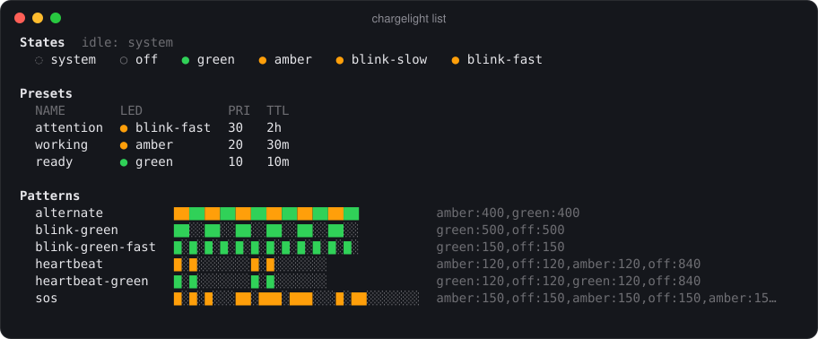
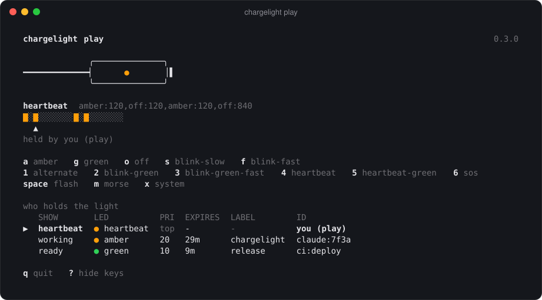
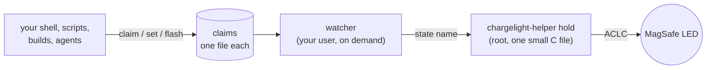

<p align="center">
  
</p>

<p align="center">
  <a href="https://github.com/TaraxioT/chargelight/actions/workflows/ci.yml"></a>
  <a href="https://github.com/TaraxioT/chargelight/releases"></a>
  
  <a href="LICENSE"></a>
</p>

The little LED on your MacBook's MagSafe connector can do more than say "charging". **chargelight** makes it programmable: a light you can read from across the room, driven by one command from a shell, a script, a build, a cron job or an AI agent.

```sh
chargelight play                     # an interactive panel: press keys, watch the light
chargelight amber                    # solid amber, until you change it
chargelight flash green              # three green flashes, then back to what it was
chargelight heartbeat --for 10m      # a pattern, for ten minutes
chargelight morse "hi"               # yes, really
chargelight run -- make test         # amber while it runs, green if it passes, blinking if it fails
chargelight system                   # hand the light back to macOS
```

## Install

You need an Apple Silicon MacBook with a MagSafe 3 port, with the charger plugged in.

```sh
brew install taraxiot/tap/chargelight
sudo chargelight setup               # once: lets the LED be changed without a password
chargelight play                     # try it: an interactive panel
```

Shell completions for zsh, bash and fish are installed with it.

## What the LED can show

**States** are what the hardware does by itself:

| State | LED |
| --- | --- |
| `amber`, `green` | solid colour |
| `blink-slow`, `blink-fast` | amber blink, built into the hardware |
| `off` | dark |
| `system` | whatever macOS wants (the normal charging light) |

**Patterns** are played by chargelight, which gives you what the hardware lacks: green blinks, two colours, rhythms.

| Pattern | |
| --- | --- |
| `blink-green`, `blink-green-fast` | green blink |
| `alternate` | amber and green in turn |
| `heartbeat`, `heartbeat-green` | two quick pulses, then a pause |
| `sos` | · · · — — — · · · |
| your own | `green:100,amber:100,off:300`: steps of `state:milliseconds`, repeated |

Anywhere a command takes a state it also takes a pattern. `chargelight list` prints all of them.

<p align="center">
  
</p>

## In the terminal

`chargelight play` is the quickest way to get a feel for it: a full-screen panel where each key changes the real light, with the pattern drawn out, a playhead moving through it, and a live table of everything else that is claiming the LED.

<p align="center">
  
</p>

The rest of the CLI dresses up the same way when a person is looking: `demo` is an animated tour, `morse` spells the message out as the light sends it, `watch` becomes a live view, and `status`, `list` and `doctor` are coloured and aligned.

None of that reaches a script. When output is piped, or with `--json` or `--quiet`, every command prints the same plain text as before, with no colour and no escape codes. `NO_COLOR` and `--no-color` switch colour off in a terminal too, and `CHARGELIGHT_NO_ANIMATION=1` keeps things still.

## Recipes

**Know when a long command ends**, and how:

```sh
chargelight run -- cargo build --release
chargelight run --keep 5m -- gh run watch --exit-status     # wait for CI
```

`run` exits with the command's own exit status, so it drops into scripts and `&&` chains unchanged.

**A notice that does not stay**:

```sh
./backup.sh; chargelight flash green --times 5
```

**A focus timer**: amber for 25 minutes, then a green blink for one:

```sh
chargelight run --working amber --ok blink-green --keep 1m -- sleep 1500
```

**Do not disturb**: dark for two hours, whatever else wants the light:

```sh
chargelight off --for 2h
```

**Hold a state for as long as something is true**, from a script:

```sh
chargelight claim deploy heartbeat --ttl 15m --label "api rollout"
./deploy.sh
chargelight release deploy
```

**Follow a stream.** `pipe` reads one instruction per line, so anything that can print can drive the light:

```sh
tail -f app.log | awk '/ERROR/ {print "blink-fast"; fflush()} /recovered/ {print "release"; fflush()}' | chargelight pipe
```

## One light, many users

Several things may want the light at once: two builds, a timer, an agent. chargelight does not let the last writer win. Each one **claims** the light under its own id, and the claim with the highest priority is shown.

```console
$ chargelight claim deploy heartbeat --priority 40 --ttl 10m --label "api rollout"
$ chargelight claim tests working --label "unit tests"
$ chargelight status
led      amber, desired heartbeat (pattern)
watcher  running
helper   installed /Library/PrivilegedHelperTools/chargelight-helper
claims   2
  SHOW       LED        PRI  EXPIRES  LABEL        ID
  heartbeat  heartbeat  40   10m      api rollout  deploy
  working    amber      20   30m      unit tests   tests
```

- **Claims expire.** Every claim has a lifetime (`--ttl`), so a script that crashes never leaves the light stuck. `run` and `pipe` renew theirs for as long as they are alive.
- **Priority decides.** A plain claim has priority 20. `flash` and `morse` use 100, so a notice shows over anything and then gets out of the way.
- **`set` is yours.** `chargelight set <state>` (or just `chargelight <state>`) overrides every claim until `chargelight system`. The claims carry on underneath and take over again when you let go.

**Presets** name a meaning instead of a colour. Three are built in, and scripts that use them keep working when you change your mind about colours:

| Preset | Shows | Priority | Lifetime |
| --- | --- | --- | --- |
| `attention` | `blink-fast` | 30 | 2 h |
| `working` | `amber` | 20 | 30 min |
| `ready` | `green` | 10 | 10 min |

Add your own presets and patterns in `~/Library/Application Support/chargelight/config.json`:

```json
{
  "presets":  { "deploy": { "led": "heartbeat", "priority": 40, "ttl": 900 } },
  "patterns": { "triple": "green:100,off:100,green:100,off:100,green:100,off:600" },
  "leds":     { "ready": "off" },
  "idle":     "system"
}
```

`leds` changes what a built-in preset shows; `CHARGELIGHT_LED_WORKING`, `_ATTENTION`, `_READY` and `_IDLE` do the same from the environment.

## Use it from a program

Every command takes `--json` and prints one JSON object. Exit codes are stable.

```console
$ chargelight claim deploy heartbeat --priority 40 --ttl 10m --label "api rollout" --json
{"accepted":true,"claim":{"expiresAt":"2026-11-25T19:41:06Z","id":"deploy","label":"api rollout","led":"heartbeat","priority":40,"show":"heartbeat","stamp":1795635066924231000,"updatedAt":"2026-11-25T19:31:06Z"},"led":"heartbeat","ok":true}

$ chargelight get --json
{"led":"amber","ok":true,"raw":4}

$ chargelight flash green --json
{"flash":{"duration":0.9,"id":"flash:41716-4ce147f5","show":"green:150,off:150","times":3},"ok":true}
```

| Code | Meaning | `error.code` |
| --- | --- | --- |
| 0 | ok | |
| 1 | failure | `io_error` |
| 2 | usage | `invalid_argument` |
| 3 | this Mac has no MagSafe LED | `unsupported_hardware` |
| 4 | the helper is not installed | `setup_required` |
| 5 | not privileged | `not_privileged` |
| 6 | SMC error | `smc_error` |

For a long-running program, keep one `chargelight pipe` open and write to it. This is Python, but it is the same three lines in any language:

```python
import subprocess

light = subprocess.Popen(["chargelight", "pipe", "--id", "trainer"], stdin=subprocess.PIPE, text=True)

def show(what):                 # a preset, a state, a pattern, or "release"
    light.stdin.write(what + "\n")
    light.stdin.flush()

show("working")
show("green:200,off:200")
light.stdin.close()             # closing it (or dying) releases the light
```

To react to the light instead of driving it, `chargelight watch --json` prints a line every time what is shown, or who is claiming it, changes. `chargelight list --json` describes every state, preset and pattern, and `chargelight status --json` the current picture.

`CHARGELIGHT_BACKEND=file` swaps the LED for a text file (`$CHARGELIGHT_HOME/led`), so code that uses chargelight can be tested in CI with no hardware and no root.

## Claude Code

A plugin makes the light follow your Claude Code sessions: amber while Claude works, a fast blink when it needs you (a permission prompt, a question, a plan to approve), green when it has finished.

```
/plugin marketplace add TaraxioT/chargelight
/plugin install chargelight@chargelight
```

It uses the same claims as everything above, one per session, so several sessions and your own scripts share the light properly: a session blocked on a prompt blinks even while others are busy, and a crashed session's claim simply expires. Hooks run in the background and take about 15 ms. `/chargelight:doctor` checks the setup, and Claude itself knows the CLI if you ask it to change something.

Nothing about the CLI is specific to Claude. Any tool with lifecycle hooks can do the same with `chargelight claim <id> working`, `... attention`, `... ready` and `chargelight release <id>`.

## The library

Add the Swift package and import `ChargeLight`:

```swift
.package(url: "https://github.com/TaraxioT/chargelight.git", from: "0.3.0")
// ...
.product(name: "ChargeLight", package: "chargelight")
```

Hold the LED in a state for as long as you need it:

```swift
import ChargeLight

let hold = try ChargeLight.hold(.amber)   // stays amber
try hold.set(.blinkFast)
hold.stop()                               // back to the charging light

let reading = try ChargeLight.read()      // works without any setup
```

Use a hold when your program owns the light. To share it with the CLI and everything else, make claims and let the watcher apply them:

```swift
let light = try StatusLight()

try light.claim(id: "my-app", show: "heartbeat", priority: 40, ttl: 600, label: "syncing", apply: false)
try Watcher.apply(light: light)           // starts chargelight's watcher if it is not running

try light.release(id: "my-app", apply: false)
try Watcher.apply(light: light)
```

`Pattern` and `PatternPlayer` are public if you want to play patterns yourself, `LEDBackend` is a protocol, and `FileBackend` is a stand-in that needs no hardware.

Writing the LED from an unprivileged process uses the same helper as the CLI, so the machine needs `sudo chargelight setup` once. A process that is already root needs nothing.

The C core is a product too (`CChargeLightSMC`, one header): `cl_led_read`, `cl_led_write`, a session API for repeated access, and generic `cl_smc_read` / `cl_smc_write` for any SMC key.

## How it works

On Apple Silicon the MagSafe LED belongs to the System Management Controller. One SMC key, `ACLC`, holds one byte: `0x00` system control, `0x01` off, `0x03` green, `0x04` amber, `0x06` slow blink, `0x07` fast blink. Anyone can read it; only root can write it.

Two things make it harder than writing a byte:

1. **Writing needs root**, and nobody wants a password prompt every time a script changes the light.
2. **A write does not last.** macOS can take the LED back within seconds (measured on a fully charged MacBook Pro), and always does when the charger is replugged.

So chargelight is built in three small layers:



- **Claims.** A command records what it wants in a small file and returns. That is why `chargelight claim` takes about 15 ms.
- **The watcher.** A background process, started on demand and gone when nothing needs the light. It picks the winning claim, reacts the moment anything changes, steps through patterns, and expires stale claims on time.
- **The helper.** The only part that runs as root. The watcher keeps one running and tells it which state to show; the helper writes it (it takes 15 to 30 ms to appear) and then checks the LED about thirty times a second, putting the state back whenever macOS has changed it. If the watcher dies, the helper notices and returns the LED to macOS.

## Security

`sudo chargelight setup` installs two files and nothing else:

- `/Library/PrivilegedHelperTools/chargelight-helper`, owned by root, mode 755
- `/etc/sudoers.d/chargelight`, which lets local users run that one binary without a password (validated with `visudo` before it goes live)

The helper is deliberately tiny ([`Sources/chargelight-helper/main.c`](Sources/chargelight-helper/main.c)). It accepts one of six fixed state names and writes the matching byte to the LED key. It opens no files, reads no environment variables and takes no other input, so the most another local user can do with it is change the colour of your charger light. Patterns, priorities and everything else happen outside it, as your user.

The sudoers rule names a root-owned copy of the helper, not the Homebrew binary, because Homebrew's files are writable by your user. No daemon is installed and nothing runs at login. The helper has its own version number, so upgrading chargelight only asks you to run setup again when the helper itself has changed.

`sudo chargelight uninstall` removes both files.

## Limitations

- **Hardware.** An Apple Silicon MacBook with MagSafe 3, charger plugged in: the LED is in the cable, so there is nothing to light on battery. Developed and tested on a 14-inch MacBook Pro (M3 Pro) running macOS 27.0.1. The `ACLC` key is undocumented and Apple could change it.
- **Two colours.** Amber and green are all the hardware has, and they are also the colours macOS uses for charging. If that is confusing, set `"idle": "off"` or give your presets patterns.
- **Brief flicker.** When macOS takes the LED back, the helper restores it within a few hundredths of a second. Now and then you may catch the blink.
- **After plugging in.** For about half a minute after the charger is connected, macOS's own charging light shows through in short flashes before the held state settles.
- **Pattern timing.** Steps shorter than 50 ms are refused, and steps under 100 ms are not always shown.
- **Interrupting Claude with Esc** fires no event, so the light can stay amber for up to a minute, until Claude Code reports the session idle.

## Troubleshooting

```console
$ chargelight doctor
ok    apple-silicon      arm64
ok    magsafe-led        AppleSMC key ACLC readable (raw 0x03, green)
ok    power-adapter      on AC power
ok    helper-installed   /Library/PrivilegedHelperTools/chargelight-helper (root-owned, mode 755)
ok    helper-version     0.1.0
ok    passwordless-sudo  sudo -n /Library/PrivilegedHelperTools/chargelight-helper works
all checks passed
```

Every failed check says how to fix it. `chargelight status` shows which claim or override is driving the light, and `chargelight reset` clears everything.

## Development

```sh
swift build
swift test                                  # no hardware and no root needed
claude plugin validate --strict ./plugin
```

The tests run against `FileBackend`, so they pass on any Mac, including CI runners with no MagSafe port. The Homebrew formula lives in [TaraxioT/homebrew-tap](https://github.com/TaraxioT/homebrew-tap).

## Credits

The LED key and its values were worked out by the people behind [batt](https://github.com/charlie0129/batt), [Battery Toolkit](https://github.com/mhaeuser/Battery-Toolkit) and [battery](https://github.com/actuallymentor/battery), whose source was the reference for this project. Others have used the LED as an agent status light in menu-bar apps, among them [pluglight](https://github.com/onelenyk/pluglight), [lamba](https://github.com/productdevbook/lamba) and [magled](https://github.com/shaoya828/magled). chargelight's take is a scriptable CLI and a library, with no app to keep running.

MagSafe is a trademark of Apple Inc. This project is not affiliated with Apple or Anthropic.

## Licence

[MIT](LICENSE)
