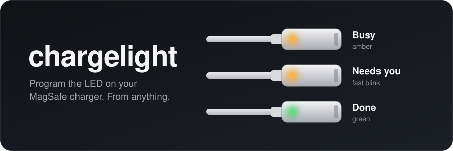
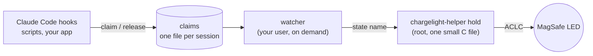

<p align="center">
  
</p>

<p align="center">
  <a href="https://github.com/TaraxioT/chargelight/actions/workflows/ci.yml"></a>
  <a href="https://github.com/TaraxioT/chargelight/releases"></a>
  
  <a href="LICENSE"></a>
</p>

The little LED on your MacBook's MagSafe connector can do more than say "charging". **chargelight** lets software drive it, and ships with a Claude Code plugin that turns it into a status light you can read from across the room:

| LED | Meaning |
| --- | --- |
| 🟠 Amber | An agent is working |
| 🟠 Fast blink | An agent needs you: a permission prompt, a question, a plan to approve |
| 🟢 Green | The agent has finished and is waiting for you |
| Normal charging light | No agent session is active |

It comes as three things, all from this repository:

- a **CLI**, `chargelight`, with JSON output and stable exit codes
- a **library**: a Swift package (`ChargeLight`) on top of a small C core (`CChargeLightSMC`)
- a **Claude Code plugin** that wires session events to the light

## Quick start

You need an Apple Silicon MacBook with a MagSafe 3 port, with the charger plugged in.

```sh
brew tap TaraxioT/chargelight https://github.com/TaraxioT/chargelight
brew install TaraxioT/chargelight/chargelight

sudo chargelight setup    # once: lets the LED be changed without a password
chargelight demo          # cycles through every state
```

Then add the plugin inside Claude Code:

```
/plugin marketplace add TaraxioT/chargelight
/plugin install chargelight@chargelight
```

Start a session and watch the connector. `/chargelight:doctor` reports whether everything is wired up.

## The Claude Code plugin

The plugin registers hooks that pass each session event to `chargelight hook`. The CLI decides what the event means:

| Claude Code event | Light |
| --- | --- |
| `UserPromptSubmit`, `PostToolUse`, `PreCompact` | working (amber) |
| `PermissionRequest`, `Elicitation`, a question or a plan awaiting approval, `StopFailure` | needs you (fast blink) |
| `Stop`, `SessionStart`, idle prompt | done (green) |
| `SessionEnd` | released |

Things it gets right that a one-line hook does not:

- **Several sessions share one light.** Each session holds its own claim and the most urgent one wins: needs-you beats working beats done. One session blocked on a prompt blinks even while three others are busy.
- **A crashed session cannot leave the light stuck.** Claims expire on their own (working after 30 minutes without an event, done after 10).
- **It never slows Claude down.** Hooks run in the background and return in about 15 ms; nothing is printed and nothing can block a tool call.
- **It is quiet when it cannot work.** On a Mac without the CLI you get one setup hint a day; on other machines the plugin does nothing.

Ask Claude about the light and it knows how to help ("why isn't my LED changing?", "turn the light off for two hours", "blink when the build fails"): the plugin includes a skill describing the CLI.

To change the colours, set any of these where Claude Code will see them, for example in the `env` block of `~/.claude/settings.json`:

```json
{ "env": { "CHARGELIGHT_LED_READY": "off", "CHARGELIGHT_LED_ATTENTION": "blink-slow" } }
```

## The CLI

```
chargelight get                         read the LED
chargelight set <state> [--for 10m]     show a state, overriding agents, until `set system`
chargelight demo                        show every state, then restore

chargelight claim <id> <status>         claim the light for an agent  [--ttl 10m] [--label text]
chargelight release <id>                drop a claim
chargelight reset                       drop every claim and any override
chargelight status                      LED, claims, override, watcher and helper
chargelight hook                        for Claude Code hooks: event JSON on stdin

chargelight setup | uninstall           install or remove the helper (with sudo)
chargelight doctor                      check this Mac and the installation
```

**States** are what the LED shows: `system`, `off`, `green`, `amber`, `blink-slow`, `blink-fast`.
**Statuses** are what an agent is doing: `working`, `attention`, `ready`. Each maps to a state.

### Use it from a script

Anything that can run a command can use the light. Give your claim an id and always a TTL, so a script that dies does not hold the light:

```sh
chargelight claim build working --label "release build" --ttl 30m
if make release; then
  chargelight claim build ready --ttl 5m
else
  chargelight claim build attention --ttl 15m
fi
```

Or override everything for a while:

```sh
chargelight set off --for 2h     # dark, whatever the agents do
chargelight set system           # hand the light back
```

### Use it from a program

Every command takes `--json` and prints exactly one JSON object:

```console
$ chargelight claim deploy working --label api --ttl 10m --json
{"accepted":true,"claim":{"expiresAt":"2026-11-25T18:23:43Z","id":"deploy","label":"api","led":"amber","stamp":1795630423527284000,"status":"working","updatedAt":"2026-11-25T18:13:43Z"},"led":"amber","ok":true}

$ chargelight get --json
{"led":"amber","ok":true,"raw":4}

$ chargelight set amber --json      # before `sudo chargelight setup`
{"error":{"code":"setup_required","message":"run: sudo chargelight setup"},"ok":false}
```

Exit codes are stable:

| Code | Meaning | `error.code` |
| --- | --- | --- |
| 0 | ok | |
| 1 | failure | `io_error` |
| 2 | usage | `invalid_argument` |
| 3 | this Mac has no MagSafe LED | `unsupported_hardware` |
| 4 | the helper is not installed | `setup_required` |
| 5 | not privileged | `not_privileged` |
| 6 | SMC error | `smc_error` |

`chargelight hook` is the exception: it never prints and always exits 0, so it is safe in any hook.

### Other agents

Nothing here is specific to Claude Code. Any tool with lifecycle hooks can call `chargelight claim <id> working`, `... attention`, `... ready` and `chargelight release <id>`, with one id per session.

### Configuration

| Variable | Effect |
| --- | --- |
| `CHARGELIGHT_LED_WORKING`, `_ATTENTION`, `_READY`, `_IDLE` | The state shown for each status, and with no claims |
| `CHARGELIGHT_HOME` | State directory (default `~/Library/Application Support/chargelight`) |
| `CHARGELIGHT_BACKEND=file` | Simulate the LED in `$CHARGELIGHT_HOME/led`: no hardware, no root. Useful in CI |
| `CHARGELIGHT_DEBUG=1` | Log hook errors to `$CHARGELIGHT_HOME/hook.log` |

The same LED mapping, plus lifetimes in seconds, can live in `config.json` in the state directory:

```json
{ "leds": { "ready": "off" }, "ttl": { "working": 3600 } }
```

## The library

Add the package and import `ChargeLight`:

```swift
.package(url: "https://github.com/TaraxioT/chargelight.git", from: "0.1.0")
// ...
.product(name: "ChargeLight", package: "chargelight")
```

Hold the LED in a state for as long as you need it:

```swift
import ChargeLight

let hold = try ChargeLight.hold(.amber)   // stays amber
try hold.set(.blinkFast)
hold.stop()                               // back to the charging light

let reading = try ChargeLight.read()      // works without any setup
print(reading.state ?? .system)
```

Use a hold when your program owns the light. To share it with the CLI and the plugin, make claims instead and let the watcher apply them:

```swift
let light = try StatusLight()

try light.claim(id: "my-agent", status: .working, ttl: 600, label: "indexing", apply: false)
try Watcher.apply(light: light)           // starts chargelight's watcher if it is not running

try light.release(id: "my-agent", apply: false)
try Watcher.apply(light: light)
```

`LEDBackend` is a protocol, and `FileBackend` is a stand-in that needs no hardware, so code built on the library is testable anywhere.

Writing the LED from an unprivileged process uses the same helper as the CLI, so the machine needs `sudo chargelight setup` once. A process that is already root needs nothing.

The C core is a product too (`CChargeLightSMC`, one header): `cl_led_read`, `cl_led_write`, a session API for repeated access, and generic `cl_smc_read` / `cl_smc_write` for any SMC key.

## How it works

On Apple Silicon the MagSafe LED belongs to the System Management Controller. One SMC key, `ACLC`, holds one byte: `0x00` system control, `0x01` off, `0x03` green, `0x04` amber, `0x06` slow blink, `0x07` fast blink. Anyone can read it; only root can write it.

Two things make it harder than writing a byte:

1. **Writing needs root**, and nobody wants a password prompt on every tool call.
2. **A write does not last.** macOS can take the LED back within seconds (measured on a fully charged MacBook Pro), and always does when the charger is replugged.

So chargelight is built in three small layers:



- **Claims.** Each session writes a small file saying what it is doing. This is all a hook does, which is why it takes 15 ms.
- **The watcher.** A background process, started on demand and gone when nothing needs the light, picks the most urgent claim, reacts the moment a claim changes, and expires stale ones.
- **The helper.** The only part that runs as root. The watcher keeps one running and tells it which state to show; the helper writes it and then checks the LED about thirty times a second, putting the state back whenever macOS has changed it. If the watcher dies, the helper notices and returns the LED to macOS.

## Security

`sudo chargelight setup` installs two files and nothing else:

- `/Library/PrivilegedHelperTools/chargelight-helper`, owned by root, mode 755
- `/etc/sudoers.d/chargelight`, which lets local users run that one binary without a password (validated with `visudo` before it goes live)

The helper is deliberately tiny ([`Sources/chargelight-helper/main.c`](Sources/chargelight-helper/main.c)). It accepts one of six fixed state names and writes the matching byte to the LED key. It opens no files, reads no environment variables and takes no other input, so the most another local user can do with it is change the colour of your charger light.

The sudoers rule names a root-owned copy of the helper, not the Homebrew binary, because Homebrew's files are writable by your user. No daemon is installed and nothing runs at login.

`sudo chargelight uninstall` removes both files.

## Limitations

- **Hardware.** An Apple Silicon MacBook with MagSafe 3, charger plugged in: the LED is in the cable, so there is nothing to light on battery. Developed and tested on a 14-inch MacBook Pro (M3 Pro) running macOS 27.0.1. The `ACLC` key is undocumented and Apple could change it.
- **Two colours.** Amber and green are all the hardware has, and they are also the colours macOS uses for charging. If that is confusing, map `ready` or `idle` to `off`.
- **Brief flicker.** When macOS takes the LED back, the helper restores it within a few hundredths of a second. Now and then you may catch the blink.
- **Interrupting Claude with Esc** fires no event, so the light can stay amber for up to a minute, until Claude Code reports the session idle.
- **After upgrading**, run `sudo chargelight setup` again if `chargelight doctor` says the helper is out of date.

## Troubleshooting

```console
$ chargelight doctor
ok    apple-silicon      arm64
ok    magsafe-led        AppleSMC key ACLC readable (raw 0x03, green)
ok    power-adapter      on AC power
ok    helper-installed   /Library/PrivilegedHelperTools/chargelight-helper (root-owned, mode 755)
ok    helper-version     0.1.0
ok    passwordless-sudo  sudo -n /Library/PrivilegedHelperTools/chargelight-helper works
all checks passed
```

Every failed check says how to fix it. `chargelight status` shows which claim or override is driving the light, and `chargelight reset` clears everything.

## Development

```sh
swift build
swift test                                  # no hardware and no root needed
claude plugin validate --strict ./plugin
```

The tests run against `FileBackend`, so they pass on any Mac, including CI runners with no MagSafe port.

## Credits

The LED key and its values were worked out by the people behind [batt](https://github.com/charlie0129/batt), [Battery Toolkit](https://github.com/mhaeuser/Battery-Toolkit) and [battery](https://github.com/actuallymentor/battery), whose source was the reference for this project. Others have had the same idea of an agent status light as a menu-bar app, among them [pluglight](https://github.com/onelenyk/pluglight), [lamba](https://github.com/productdevbook/lamba) and [magled](https://github.com/shaoya828/magled). chargelight's take is a scriptable CLI, a library and a plugin with no app to keep running.

MagSafe is a trademark of Apple Inc. This project is not affiliated with Apple or Anthropic.

## Licence

[MIT](LICENSE)
